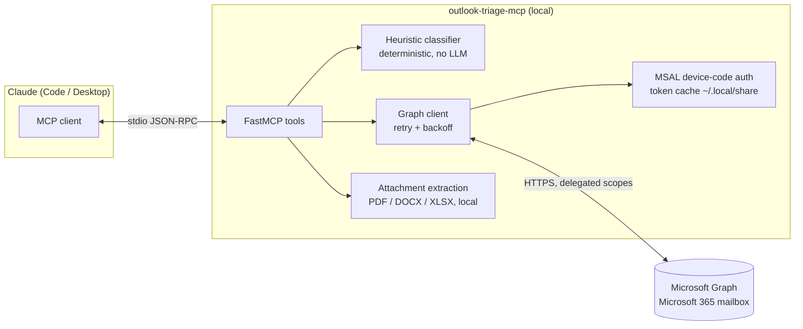

# outlook-triage-mcp

MCP server for Microsoft 365 mail — search, classify, and triage your inbox from Claude via Microsoft Graph: daily-briefing digest, idempotent inbox-rule provisioning, attachment extraction. Device-code auth, read-only by default.

---

## 🇺🇸 English

Your inbox, triaged by Claude — without handing anyone your password. This MCP server connects Claude (Code or Desktop) to a Microsoft 365 mailbox through Microsoft Graph, using device-code sign-in and a local token cache. It classifies mail with deterministic keyword heuristics (no LLM calls at runtime, no message content leaving your machine beyond what you ask Claude to read), builds a morning briefing, and can — only if you explicitly opt in — provision inbox rules idempotently.

### Features

- **Daily briefing** — classifies the last N hours of inbox mail into `urgent` / `action_needed` / `fyi` / `newsletter` and renders a Markdown digest. Heuristics are deterministic and configurable (env vars or a JSON file); messages you already read are never flagged as pending.
- **Search & read** — Graph `$search`/`$filter` message search in any folder; full plain-text bodies; local text extraction from PDF / DOCX / XLSX attachments (pypdf, python-docx, openpyxl — parsing is 100% local).
- **Idempotent inbox rules** — `ensure_inbox_rule` converges mailbox state: an already-correct rule triggers **zero** write calls, a divergent one is patched, a missing one is created (folder included). Run it a hundred times, get one rule.
- **Device-code auth** — MSAL public-client flow: the `auth_status` tool hands you a URL and a code; sign in from any browser. Tokens are cached in `~/.local/share/outlook-triage-mcp/` (never in the repo, `0600` permissions) and refreshed silently.
- **Read-only by default** — the server requests only `Mail.Read` / `MailboxSettings.Read` scopes unless you set `OUTLOOK_MCP_ENABLE_WRITE=1`.
- **Retry/backoff** — Graph calls honor `Retry-After` on 429 and back off exponentially on 5xx.

### ⚠️ Write access

**`ensure_inbox_rule` is the ONLY tool that writes to your mailbox.** Every other tool is strictly read-only (and annotated as such in the MCP tool metadata). Rule provisioning is disabled by default: the tool refuses to run until you start the server with `OUTLOOK_MCP_ENABLE_WRITE=1` and re-authenticate with write scopes. The server never sends, deletes, moves, or marks messages.

### Tools

| Tool | Access | Description |
| --- | --- | --- |
| `auth_status()` | read-only | Token state; starts device-code sign-in and returns the URL + code when login is needed |
| `search_messages(query, folder="inbox", top=20, since=None)` | read-only | Search (KQL) or list messages; `since` accepts ISO 8601 or relative (`24h`, `7d`) |
| `get_message(message_id, include_attachments=False)` | read-only | Full body + metadata; optionally extracts text from PDF/DOCX/XLSX attachments locally |
| `daily_briefing(hours=24)` | read-only | Markdown digest classified into urgent / action_needed / fyi / newsletter |
| `list_inbox_rules()` | read-only | Inventory of inbox rules with conditions and actions |
| `ensure_inbox_rule(name, from_contains, move_to_folder)` | **WRITE** | Idempotently converge one rule (sender contains X → move to folder Y); creates the folder if missing |

Example prompts once connected:

> "Give me my daily briefing for the last 48 hours."
> "Search my inbox for messages about the Q3 invoice and read the newest one, including attachments."
> "Make sure there's a rule moving everything from recruiting@ to a Recruiters folder." *(requires write mode)*

### How it works



### Install

```bash
git clone https://github.com/giuseppeferretti/outlook-triage-mcp
cd outlook-triage-mcp
python -m venv .venv && source .venv/bin/activate
pip install -e ".[attachments]"    # attachments extra enables PDF/DOCX/XLSX parsing
```

### Configure Claude

**Claude Code:**

```bash
claude mcp add outlook-triage -- /path/to/.venv/bin/outlook-triage-mcp
```

**Claude Desktop** (`claude_desktop_config.json`):

```json
{
  "mcpServers": {
    "outlook-triage": {
      "command": "/path/to/.venv/bin/outlook-triage-mcp",
      "env": {
        "OUTLOOK_MCP_USER_EMAIL": "you@yourcompany.com"
      }
    }
  }
}
```

First use: ask Claude to call `auth_status`, open the verification URL it returns, type the code, done. The token is cached locally; you will rarely need to sign in again.

### Configuration (env vars)

| Variable | Default | Purpose |
| --- | --- | --- |
| `OUTLOOK_MCP_CLIENT_ID` | Microsoft Graph CLI public client (`14d82eec-…`) | Azure AD app registration. The default is Microsoft's own Graph CLI public client, which is pre-authorized for delegated mail scopes on most tenants (the older Azure CLI client is blocked for `Mail.*` — AADSTS65002). If your tenant blocks it, register your own public-client app with device-code flow and delegated `Mail.Read` + `MailboxSettings.Read`, and set this variable. |
| `OUTLOOK_MCP_TENANT_ID` | `common` | Restrict sign-in to a specific tenant |
| `OUTLOOK_MCP_USER_EMAIL` | — | Your address; used to pick the cached account and to classify self-sent mail |
| `OUTLOOK_MCP_ENABLE_WRITE` | `0` | Set `1` to enable `ensure_inbox_rule` (requests write scopes on next sign-in) |
| `OUTLOOK_MCP_CACHE_DIR` | `~/.local/share/outlook-triage-mcp` | Token cache location |
| `OUTLOOK_MCP_CLASSIFY_FILE` | — | JSON file overriding heuristic keyword lists |
| `OUTLOOK_MCP_URGENT_KEYWORDS` / `OUTLOOK_MCP_ACTION_KEYWORDS` / `OUTLOOK_MCP_NEWSLETTER_SENDERS` / `OUTLOOK_MCP_NEWSLETTER_KEYWORDS` / `OUTLOOK_MCP_VIP_SENDERS` | built-in lists | Comma-separated overrides for individual heuristic lists |
| `OUTLOOK_MCP_MAX_ATTACHMENT_BYTES` | `5242880` | Attachments larger than this are listed, not parsed |

Classification file example (`classify.json`):

```json
{
  "urgent_keywords": ["urgent", "asap", "outage"],
  "action_keywords": ["please review", "sign off"],
  "vip_senders": ["ceo@yourcompany.com"],
  "newsletter_sender_patterns": ["noreply@", "digest@"]
}
```

### Development

```bash
pip install -e ".[dev]"
pytest              # all offline: fixture JSON + fake Graph + stdio smoke test
OUTLOOK_MCP_LIVE_TESTS=1 pytest tests/test_graph_live.py   # optional, real Graph
```

The test suite requires **no Microsoft account**: classification and rule-idempotency tests run against fake Graph responses, and the MCP smoke test boots the real stdio server with the official SDK client and verifies the tool list and graceful auth-required behavior.

### Provenance

This server was extracted from a **production Microsoft 365 automation system** — a daily-briefing robot and idempotent inbox-rule provisioner that runs every morning for a real controllership workflow. The battle-tested parts were kept (device-code auth with token cache, Graph retry/backoff, write-free classification, converge-don't-duplicate rule provisioning) and the client-specific heuristics were genericized into configurable keyword lists. Case study at [portfolio.iterlabs.com.br](https://portfolio.iterlabs.com.br).

---

## 🇧🇷 Português

Servidor MCP para e-mail Microsoft 365 — busque, classifique e faça triagem da sua caixa de entrada pelo Claude via Microsoft Graph. Autenticação por device-code (sem senha no servidor), token em cache local, **somente leitura por padrão**.

### Recursos

- **Briefing diário**: classifica as últimas N horas em `urgent` / `action_needed` / `fyi` / `newsletter` com heurísticas determinísticas (sem LLM em runtime), configuráveis por env ou arquivo JSON. Mensagens já lidas nunca aparecem como pendentes.
- **Busca e leitura**: pesquisa Graph em qualquer pasta, corpo completo em texto e extração local de texto de anexos PDF / DOCX / XLSX.
- **Regras idempotentes**: `ensure_inbox_rule` converge o estado da caixa — regra já correta gera **zero** chamadas de escrita; nunca duplica regra nem pasta.
- **Retry/backoff** nas chamadas Graph (respeita `Retry-After` em 429).

### ⚠️ Escrita

**`ensure_inbox_rule` é a ÚNICA ferramenta que escreve na caixa.** Todas as outras são somente leitura. Escrita fica desabilitada até você definir `OUTLOOK_MCP_ENABLE_WRITE=1` e autenticar novamente com escopos de escrita. O servidor nunca envia, exclui, move ou marca mensagens.

### Instalação e uso

```bash
git clone https://github.com/giuseppeferretti/outlook-triage-mcp
cd outlook-triage-mcp
python -m venv .venv && source .venv/bin/activate
pip install -e ".[attachments]"
claude mcp add outlook-triage -- /caminho/para/.venv/bin/outlook-triage-mcp
```

No primeiro uso, peça ao Claude para chamar `auth_status`: ele devolve uma URL e um código — abra no navegador, digite o código e pronto. O token fica em cache em `~/.local/share/outlook-triage-mcp/` (nunca no repositório).

Configuração principal: `OUTLOOK_MCP_CLIENT_ID` (padrão: client público do Microsoft Graph CLI; registre seu próprio app se o tenant bloquear), `OUTLOOK_MCP_TENANT_ID`, `OUTLOOK_MCP_USER_EMAIL`, `OUTLOOK_MCP_ENABLE_WRITE` e as listas de palavras-chave `OUTLOOK_MCP_*_KEYWORDS` / `OUTLOOK_MCP_VIP_SENDERS`.

Testes: `pytest` roda 100% offline (fixtures JSON + Graph falso + smoke test MCP stdio com o SDK oficial). Testes contra o Graph real são opcionais: `OUTLOOK_MCP_LIVE_TESTS=1`.

### Origem

Extraído de um sistema de automação Microsoft 365 **em produção** (robô de briefing diário + provisionamento idempotente de regras), com as heurísticas do cliente genericizadas em listas configuráveis. Case em [portfolio.iterlabs.com.br](https://portfolio.iterlabs.com.br).

---

*Built with AI-assisted development; designed, verified, and operated by Giuseppe Ferretti.*
